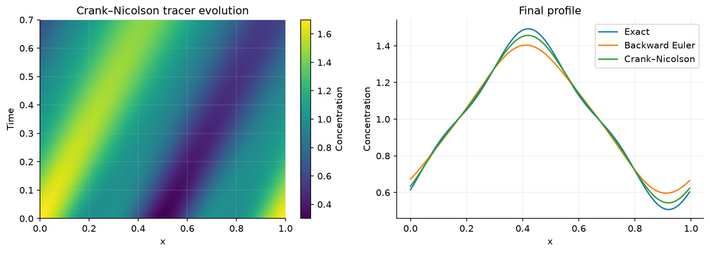

# Scientific Computing | Simulation and Modelling 2

A practical study companion to Nikki Vercauteren’s Simulation and Modelling 2 lectures at the University of Cologne. Start with the original foundations, then use numerical experiments to connect mathematical models to ODEs, PDEs and fluid transport.

**Start here:** [Learning path](#learning-path) · [Set up and run](#run-locally) · [Source coverage](docs/SOURCES.md) · [Figure gallery](docs/FIGURES.md) · [Implementation prompt](docs/IMPLEMENTATION_PROMPT.md)



## Learning path

| Unit | What you will do |
|---|---|
| [Foundations](01_Foundations/README.md) | States, functions, Taylor expansions, finite differences and quadrature. |
| [Modelling and dimensional analysis](02_Dimensional_Analysis/README.md) | Formulate and verify models; use Buckingham Pi, physical scales and redimensionalisation. |
| [Flow modelling](03_Flow_Modelling/README.md) | Derive diffusion from conservation, construct the similarity solution and analyse Fourier modes. |
| [Time integration](04_Time_Integration/README.md) | Choose one-step ODE methods and compare stiffness, accuracy and Hamiltonian structure. |
| [Numerical errors](05_Numerical_Errors/README.md) | Separate spatial and temporal error in a controlled experiment. |
| [Space discretisation](06_Space_Discretization/README.md) | Build periodic finite differences and compare PDE time integrators. |
| [Stability](07_Stability/README.md) | Distinguish amplification, dissipation, phase error and the advection CFL limit. |
| [Finite element method](08_Finite_Element_Method/README.md) | Derive the weak form, assemble the system and verify convergence. |
| [Characteristics](10_Characteristics/README.md) | Follow linear transport along curves; explore Burgers shock onset as a supplement. |
| [Exercises and capstone](09_Exercises/README.md) | Consolidate the course with practice and a verified tracer simulation. |

## Run locally

Python 3.11 or newer is recommended. From the repository root:

```bash
python3 -m venv .venv
source .venv/bin/activate
python -m pip install -r requirements.txt
python scripts/verify_notebooks.py
```

Open any notebook in VS Code or Jupyter and choose the project environment. Run the cells from the top. The verification command uses a fresh Python kernel per notebook and regenerates the figures. Add `--write` to save refreshed inline outputs. No data downloads or network access are needed after installing dependencies.

## Scope

This is an independent study companion with original explanations, numerical experiments and figures. It covers the substantive sections of both supplied lecture files; logistics are referenced in the source map rather than repeated. Burgers’ equation extends a heading with no exposition in the notes. Scientific machine learning is a possible follow-on, outside the supplied lecture scope. The examples verify mathematical behaviour; they are not observational validation.

The supplied lecture PDFs are not redistributed. See [source attribution and corrections](docs/SOURCES.md), [verification results](docs/VERIFICATION.md), and [licence](LICENSE).
