# Figure gallery

[Course index](../README.md)

## Truncation, roundoff and quadrature convergence

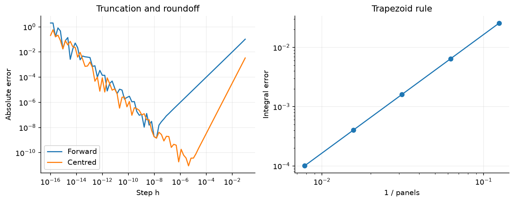

## Model, parameter and discretisation errors

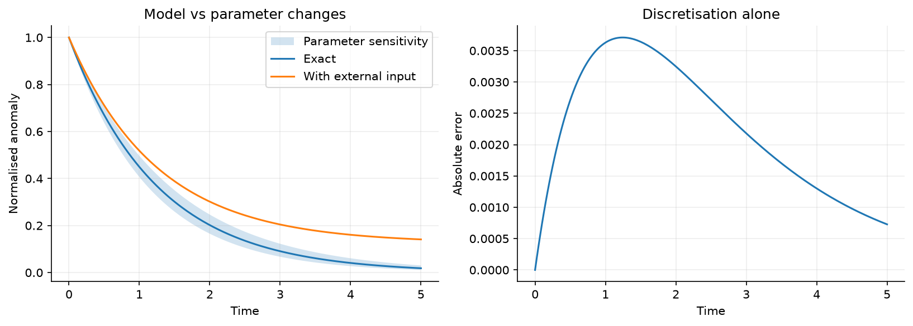

## Scaling collapse of exponential decay

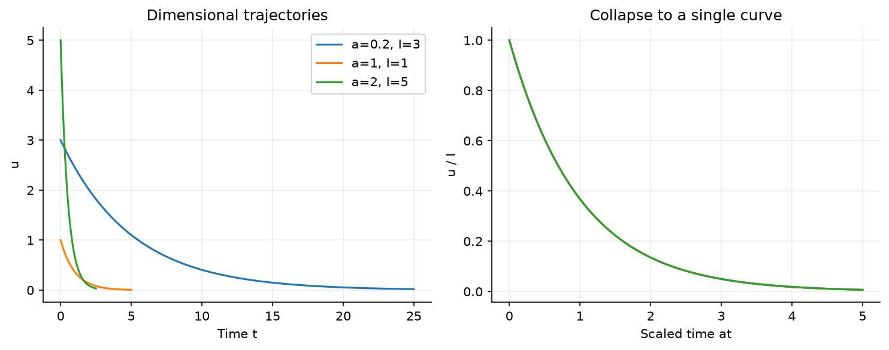

## Random-walk diffusion and similarity

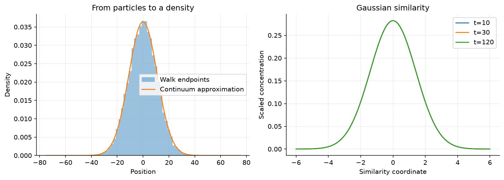

## Fourier-mode decay and phase shift

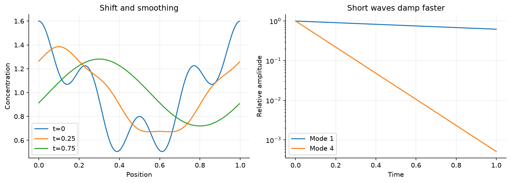

## Observed ODE convergence orders

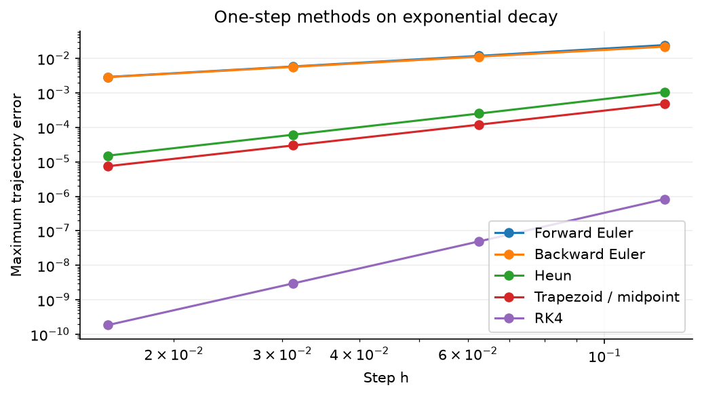

## Absolute stability and fast-mode behaviour

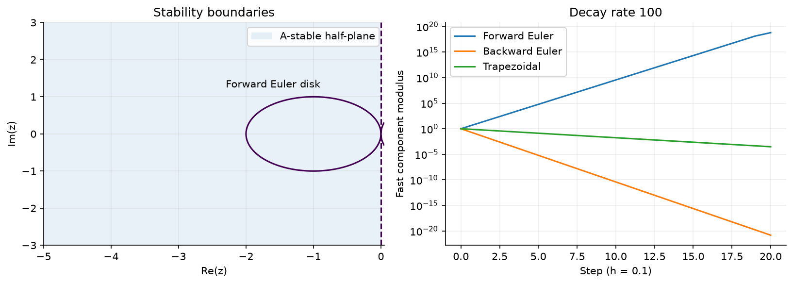

## Phase portraits and energy behaviour

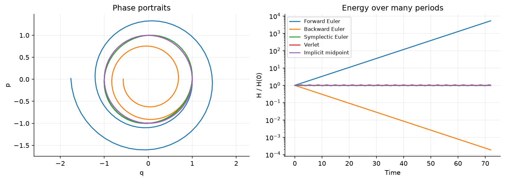

## Separating time and space errors

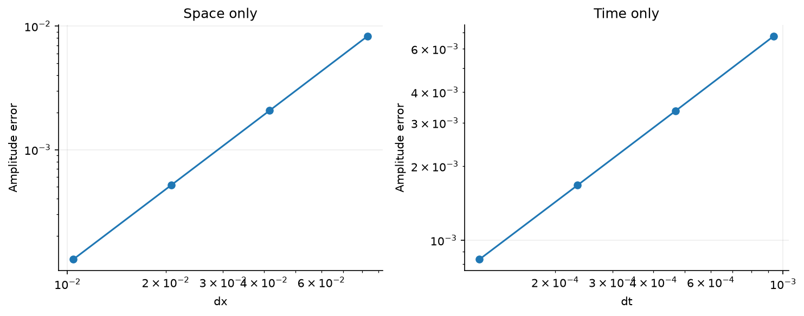

## Diffusion stability and grid refinement

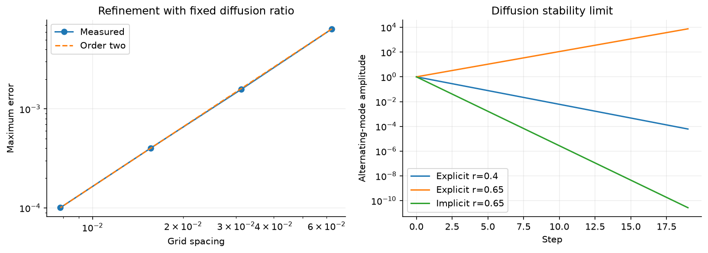

## Space–time tracer evolution and final profile

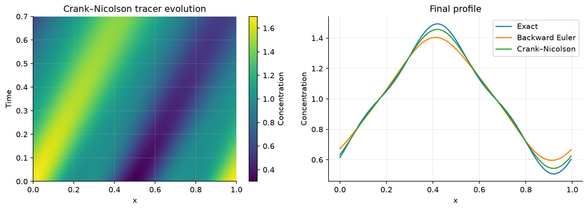

## Upwind amplitude and phase errors

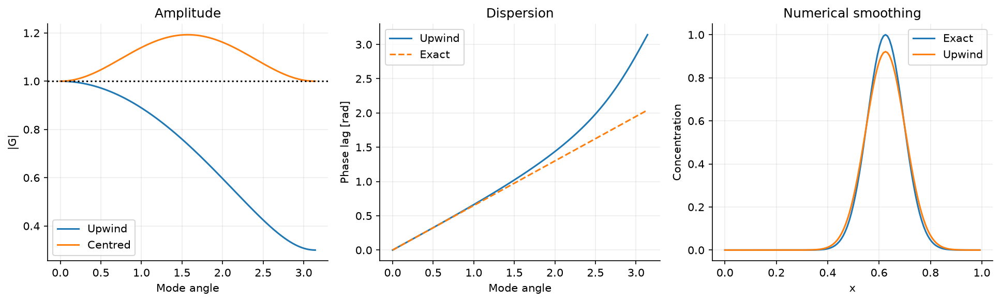

## Hat basis, numerical solution and FEM refinement

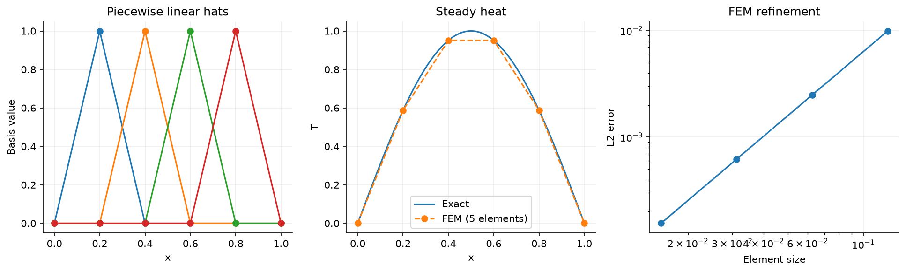

## Tracer verification and refinement

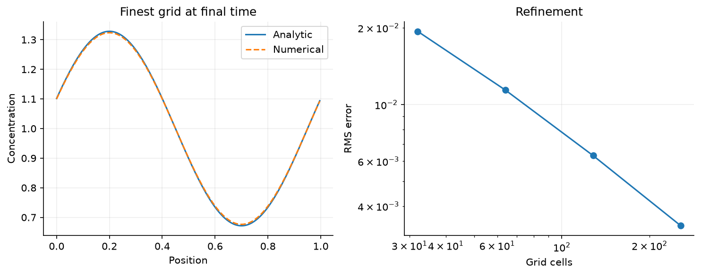

## Characteristic curves and transport

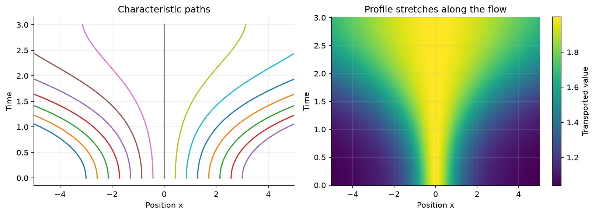

## Burgers characteristics and a separate entropy shock

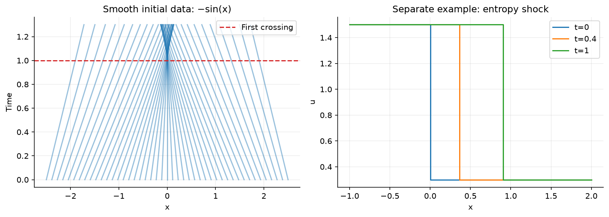

## State: original Turkish visual examples

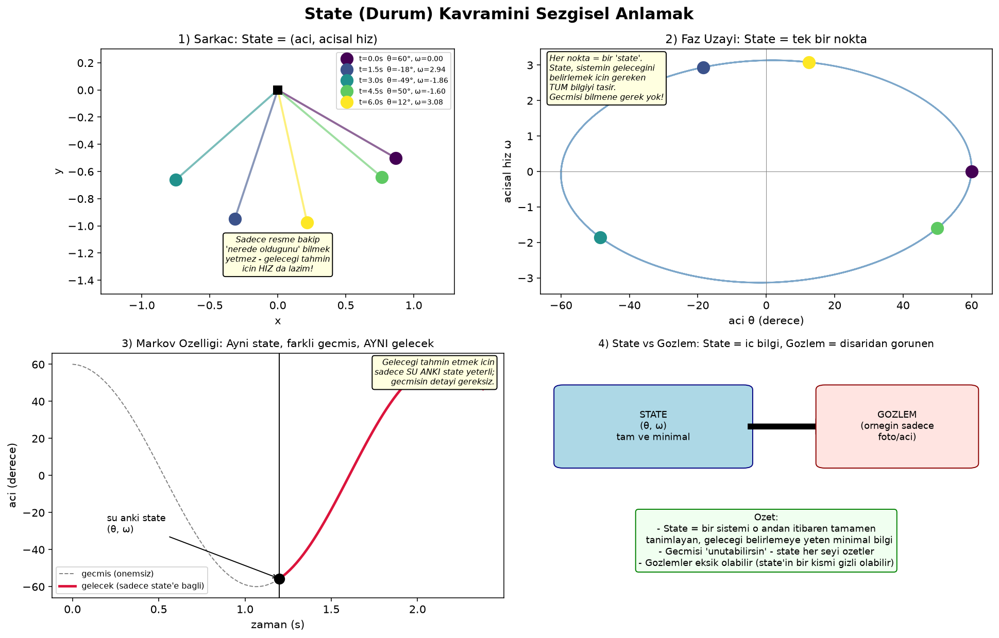
